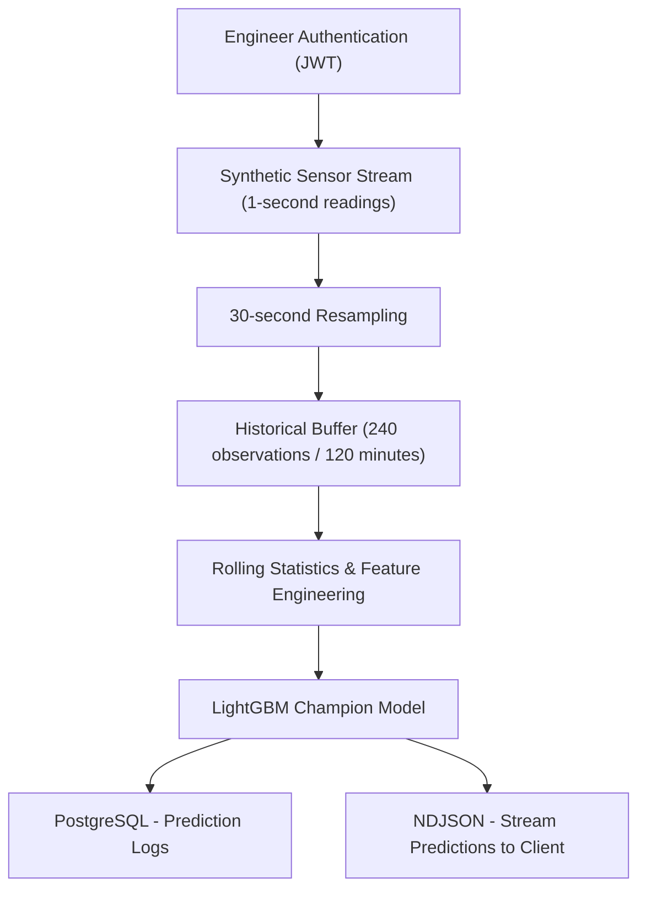

# 🛢️ Oil Well Fault Detection — Predictive Maintenance with Machine Learning

> Detecting early fault conditions, using real-world sensor data from the 3W Dataset.

---

## Overview

This project develops a machine learning-based fault detection system for offshore oil wells using the Petrobras 3W Dataset. The objective is to identify early fault conditions by distinguishing normal well operation from five transient fault states.

The original time-series sensor readings were resampled into 30-second observations and used to train and evaluate several classification models. The selected LightGBM champion was subsequently integrated into a containerized inference system using FastAPI, PostgreSQL, MLflow and Docker.

The project emphasises **early fault detection** — identifying the transient warning period before a fault fully develops, which is where predictive maintenance delivers the most value.

---

## System Architecture


## System Architecture




## Dataset

**Source:** [3W Dataset — Petrobras / UCI Machine Learning Repository](https://archive.ics.uci.edu/dataset/540/3w+dataset)

The 3W dataset contains time-series recordings from real oil wells (WELL), physics-based simulations (SIMULATED), and domain-expert hand-drawn scenarios (DRAWN).

### Fault Classes

| Class | Description |
|-------|-------------|
| 0 | Normal Operation |
| 1 | Abrupt Increase of BSW |
| 2 | Incipient Leak in Production Choke |
| 3 | Flow Instability |
| 4 | Rapid Productivity Loss |
| 5 | Quick Restriction in Production Choke |
| 6 | Scaling in Production Choke |
| 7 | Hydrate in Production Line |
| 8 | Hydrate in Service Line |
| 10X | Transient period leading into Fault X (e.g. 101 = early warning for Fault 1) |

### Process and Problem
For the project, model was trained on transient faults only, as it is a predictive model. class 3 and 4 had no transient records and class 106, had very little sample to accurately generalise. Until more samples for this class is generated, it was excluded in the final model. The biggest problem in the dataset is the highly imbalanced structure. This led to different experimentation like SMOTE based sampling, which was later rejected as a valid technique due to the time series data at hand, Rolling windows aggregation and aggressive feature engineering.

---

## Sensors
### Original Dataset Sensors

| Column | Description | Unit |
|--------|-------------|------|
| P-PDG | Pressure — Permanent Downhole Gauge | bar |
| P-TPT | Pressure — Topside Transducer | bar |
| T-TPT | Temperature — Topside Transducer | °C |
| P-MON-CKP | Pressure upstream of Production Choke | bar |
| T-JUS-CKP | Temperature downstream of Production Choke | °C |
| T-JUS-CKGL | Temperature downstream of the Gas Lift Choke | °C |
| P-JUS-CKGL | Pressure downstream of Gas Lift Choke | bar |
| QGL | Gas Lift Flow Rate | m³/s |
| gas_lift_active | Binary flag — whether gas lift was active | 0/1 |

---

### Sensors Used in the Final Model

| Column | Description | Unit |
|--------|-------------|------|
| P-TPT | Pressure — Topside Transducer | bar |
| T-TPT | Temperature — Topside Transducer | °C |
| P-MON-CKP | Pressure upstream of Production Choke | bar |
| T-JUS-CKP | Temperature downstream of Production Choke | °C |
| P-JUS-CKGL | Pressure downstream of Gas Lift Choke | bar |
| QGL | Gas Lift Flow Rate | m³/s |
| gas_lift_active | Binary flag — whether gas lift was active | 0/1 |

P-PDG and T-JUS-CKGL were excluded because of unreliable or unavailable measurements. The remaining sensor readings, together with engineered features, formed the input to the final model.

## Key Challenges

- **Class imbalance** — Normal operation (class 0) has 80x more samples than rare faults like class 7
- **Sensor corruption** — P-PDG had systematic zero readings spanning multiple days due to downhole sensor failures
- **Missing sensors** — T-JUS-CKGL not installed on any well in this dataset
- **Transient class ambiguity** — Classes 101–108 look nearly identical to class 0 in raw sensor readings, making early detection inherently difficult


## Methodology and Engineering Decisions

### Data Cleaning and Feature Engineering

The original sensor data was cleaned to address missing and unreliable readings. The `P-PDG` and `T-JUS-CKGL` sensors were excluded due to unavailable or unreliable measurements. The dataset, originally recorded at 1-second intervals, was then **resampled into 30-second observations** to reduce data volume while preserving important operational patterns.

Feature engineering was performed using rolling-window statistics and derived features to capture changes in well behaviour over time. These included rolling means, standard deviations, pressure differences, and temperature-pressure relationships, such as `T_P_divergence = T-TPT / (P-TPT + 1)`. These features were designed to provide additional information beyond individual sensor readings and help the model identify useful patterns during training. Stability streak, which was a feature engineered column was the highest scoring column in feature importances.

### Model Selection and Validation

Three machine learning algorithms — **LightGBM, XGBoost, and Random Forest** — were evaluated across three different dataset configurations to determine the most suitable approach for detecting transient fault conditions.

Model evaluation used **3-fold Stratified Group Cross-Validation**, with `Instance_id` serving as the grouping variable. This ensured that observations belonging to the same well-fault instance were not shared between training and validation folds, reducing the risk of data leakage and providing a more realistic assessment of model generalization.

Based on the experimental results, **LightGBM was selected as the final champion model** for the fault detection system.


---

## Model Evaluation and Results

### Experimental Evaluation

After months of restructuring datasets, tuning hyperparameters, and experimenting with different machine learning algorithms, the objective remained the same: accurately identify early fault conditions while minimizing missed detections.

Initially, **macro recall** was the primary evaluation metric, with early experiments producing scores as low as **0.20–0.51**. These results highlighted the difficulty of identifying minority fault classes, even when overall model accuracy appeared reasonable.

Further experiments focused on improving the balance between precision and recall, with **macro F1-score** adopted as the main model-selection metric.

### Model Comparison

Three classification algorithms — **LightGBM, XGBoost, and Random Forest** — were evaluated across three dataset configurations using grouped cross-validation.

| Model | Original Dataset | Without Classes 3 & 4 | Transient-Focused Dataset |
|---|---:|---:|---:|
| LightGBM | 81.62% | 83.37% | **88.67%** |
| Random Forest | 78.61% | 79.31% | 84.59% |
| XGBoost | 56.83% | 67.78% | 85.85% |

*Values represent macro F1-scores from earlier experiments. Dataset configurations differed, so these scores should not be treated as directly comparable to the final champion evaluation.*

LightGBM consistently performed well across the experiments, particularly when the training data focused on transient fault conditions.

Additional experiments investigated wavelet-based features to capture variations in sensor signals. However, these features did not consistently improve performance over the statistical feature set and were therefore excluded from the final model.

### Final Champion Model — LightGBM

Following further dataset refinement and model evaluation, LightGBM was selected as the final champion for six operating classes: **0, 101, 102, 105, 107, and 108**.

The model was evaluated using **3-fold StratifiedGroupKFold cross-validation**, grouping observations by `Instance_id` to prevent readings from the same fault instance appearing in both training and validation folds.

| Evaluation Metric | Final Score |
|---|---:|
| **Macro F1-score** | **97.70%** |
| Balanced Accuracy (Macro Recall) | 97.28% |
| Overall Accuracy | 97.97% |
| Macro F1 — Fold 1 | 97.02% |
| Macro F1 — Fold 2 | 97.76% |
| Macro F1 — Fold 3 | 98.32% |

The **97.70% macro F1-score** indicates that the model achieved a strong balance between precision and recall across the six evaluated classes, giving equal importance to each class regardless of its number of observations.

The **97.28% balanced accuracy** indicates that the model correctly identified a high proportion of observations across the different classes, rather than achieving a good result simply by favouring the majority class.

The relatively consistent results across three validation folds also provide encouraging evidence of the model's performance on held-out fault instances.

### Limitations

Despite the strong evaluation results, several limitations remain:

- **Insufficient data for Class 106:** Class 106 was excluded from the final training dataset because it contained only three independent fault instances. This provided insufficient evidence for reliable evaluation using the chosen grouped cross-validation approach. The model therefore cannot reliably identify this fault class and may incorrectly classify it as one of the known classes.

- **Limited fault coverage:** The champion classifies normal operation and five transient fault states, not every fault category in the original Petrobras 3W dataset.

- **Class imbalance:** Certain fault types contain significantly fewer independent instances than others. Although grouped cross-validation reduces data leakage, limited fault diversity can still affect generalization.

- **Unseen well behaviour:** Validation was grouped by fault instance, not necessarily by physical well. Performance on entirely new wells or different operating conditions remains uncertain.

- **Real-time validation:** The deployed FastAPI system was tested using synthetic streaming sensor readings. While this verifies the inference workflow, it does not establish performance on live industrial sensor streams.

- **Prediction confidence:** High model probability scores do not necessarily guarantee correct predictions. Additional probability calibration and monitoring would be valuable before operational deployment.

Overall, the final results demonstrate promising performance for transient fault classification under instance-grouped validation. However, **reliable industrial deployment would require further testing on independent wells, additional rare-fault data, and real-world streaming conditions**.

---


## MLOps and Deployment

Following model selection and evaluation, the project was extended beyond experimentation into a containerized machine learning inference system, incorporating model management, API development, database integration and automated build workflows, showcasing my MLOps proficiency.

### Experiment Tracking and Model Registry — MLflow

**MLflow** was used to track model experiments, including hyperparameters, evaluation metrics and model artifacts. PostgreSQL served as the MLflow backend database, providing persistent storage for experiment metadata.

After evaluating the different model configurations, the final LightGBM pipeline was retrained on the selected dataset and registered in MLflow as `Oil_Well_Fault_Detector`, with the alias `champion`.

For deployment, the registered champion was exported from MLflow and packaged with the application, allowing inference without requiring a live connection to the MLflow registry.

### Model Serving — FastAPI

A REST API was developed using **FastAPI** to expose the fault detection system.

The application includes a simulated real-time inference workflow that:

1. Reads synthetic oil-well sensor observations at simulated 1-second intervals.
2. Aggregates every 30 readings into a single 30-second observation.
3. Maintains a rolling history of 240 observations (120 minutes).
4. Performs rolling-window calculations and feature engineering before passing the latest observation to the trained LightGBM pipeline.
5. Streams predictions and associated probability scores to the client using newline-delimited JSON (NDJSON).

The API also implements **JWT-based authentication using OAuth2 Bearer tokens**, allowing engineers to register, log in, access protected endpoints and retrieve their account information.

### Database Integration — PostgreSQL

PostgreSQL was integrated with FastAPI using **SQLModel and SQLAlchemy** to provide persistent storage for engineer accounts and prediction logs.

Each prediction record stores the well identifier, timestamp, predicted fault class, confidence score and the engineer associated with the prediction request.

This provides a foundation for prediction history, traceability and future monitoring capabilities.

### Containerization — Docker

The inference application was containerized using **Docker** to provide a consistent runtime environment containing the FastAPI application, required Python dependencies, preprocessing logic and exported LightGBM model.

A dedicated API requirements file was created to exclude unnecessary development dependencies such as Jupyter and DVC from the inference environment.

The container connects to PostgreSQL running on the host machine through `host.docker.internal` during local testing. Configuration values and sensitive credentials are supplied through environment variables rather than embedded in the Docker image.

### Continuous Integration and Image Publishing — GitHub Actions

A GitHub Actions workflow was configured to automate testing and Docker image publishing when changes are pushed to the `main` branch.

The workflow consists of two dependent jobs:

- **Test and Lint:** Installs the required Python dependencies, runs automated tests using Pytest and checks for critical Python errors using Flake8.
- **Build and Push:** Builds the Docker image and publishes it to Docker Hub, provided the preceding job succeeds.

Docker Hub credentials are managed using GitHub Actions secrets.

This workflow supports repeatable builds and automated image publishing. Deployment to a publicly accessible production environment remains a separate future step.

### Current Deployment Scope

The system has been tested locally with containerized FastAPI inference, a packaged champion model and PostgreSQL-backed prediction logging.

The streaming workflow currently uses synthetic sensor readings rather than a live industrial data source.&#x20;


## Getting Started — Docker

The fault detection system is packaged as a Docker image containing the FastAPI application, preprocessing pipeline, required dependencies and trained LightGBM champion model.

You can run the application without cloning the repository or installing Python dependencies locally.

### Prerequisites

- Docker Desktop installed and running.
- A running PostgreSQL server with the `mars_oil` database and required application tables initialized.
- Access to the published Docker Hub image.

### 1. Pull the Docker Image

Download the latest image from Docker Hub:

```bash
docker pull marsprojects/oilwellfaultdetector:latest
```


### 2. Configure Environment Variables

Create a file named `.env` on your computer and provide the following configuration:

```dotenv
DB_USER=postgres
DB_PASSWORD=your_postgresql_password
DB_HOST=host.docker.internal
DB_PORT=5432
DB_NAME=mars_oil

SECRET_KEY=your_secure_random_secret_key
```

`DB_HOST=host.docker.internal` allows a Docker Desktop container to connect to PostgreSQL running on the host computer.

The database credentials must match your own PostgreSQL setup. The JWT signing key should be a securely generated random value.

### 3. Run the Docker Container

From the directory containing your `.env` file:

```bash
docker run --rm \
  --name oilwellfaultdetector \
  --env-file .env \
  -p 8000:8000 \
marsprojects/oilwellfaultdetector:latest
```

The application should be accessible at:

**[http://127.0.0.1:8000/docs](http://127.0.0.1:8000/docs)**

### 4. Test the API

FastAPI provides interactive API documentation through Swagger UI.

| Endpoint                | Method | Description                                   |
| ----------------------- | ------ | --------------------------------------------- |
| `/auth/register`        | POST   | Register an engineer                          |
| `/auth/login`           | POST   | Authenticate and obtain a JWT                 |
| `/auth/me`              | GET    | Retrieve the authenticated engineer's details |
| `/predict/live-predict` | GET    | Stream simulated fault predictions            |
| `/auth/logout`          | POST   | Log out the authenticated engineer            |

To test the application, register an engineer, authenticate using Swagger's **Authorize** button, and execute `/predict/live-predict`.

The prediction endpoint simulates incoming sensor readings and returns newline-delimited JSON (NDJSON). Each response contains the predicted fault class, probability score, timestamp and synthetic ground-truth class.

Because NDJSON contains multiple JSON objects, Swagger may display a JSON parsing warning even when the stream is operating correctly.

For direct terminal streaming, use:

```bash
curl -N \
  -H "Authorization: Bearer YOUR_ACCESS_TOKEN" \
  http://127.0.0.1:8000/predict/live-predict
```

Replace `YOUR_ACCESS_TOKEN` with the JWT returned after login.

### Notes

- The synthetic sensor dataset and trained champion model are already included in the Docker image.
- PostgreSQL remains an external dependency and must be configured before testing database-backed endpoints.
- The streaming predictions are demonstrations of the inference workflow, not validation against live industrial sensor data.
- The Docker image is intended for local demonstration and testing, not as a production-ready deployment.


---

## References

- Vargas, R. et al. (2019). *A realistic and public dataset with rare undesirable real events in oil wells.* Journal of Petroleum Science and Engineering.
- [3W Dataset GitHub](https://github.com/ricardovvargas/3w_dataset)
- [UCI ML Repository — 3W Dataset](https://archive.ics.uci.edu/dataset/540/3w+dataset)
